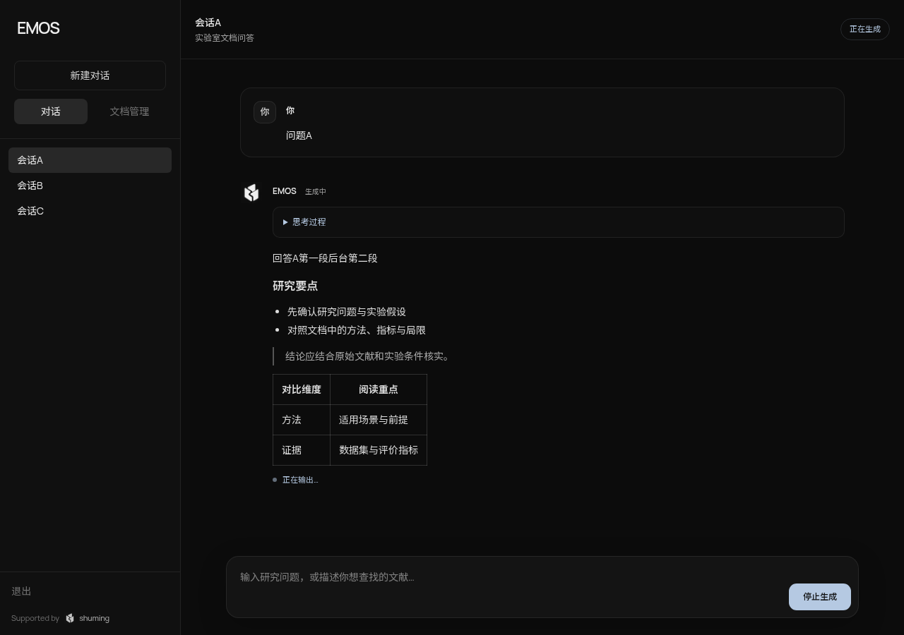

<p align="center">
  
</p>

<h1 align="center">shuming · 枢明</h1>

<p align="center">面向研究团队的知识库与 AI 研究助手</p>

<p align="center">
  <a href="docs/getting-started.md">快速开始</a> ·
  <a href="ARCHITECTURE.md">系统架构</a> ·
  <a href="docs/native-mcp.md">MCP 接入</a> ·
  <a href="tests/README.md">评测指南</a>
</p>

---

shuming 将论文管理、知识检索与工具调用整合到同一套工作流中。研究者可以在 **EMOS** 对话界面中查询团队知识、读取论文证据并下载来源文件，也可以通过 REST API 或 MCP 将知识库接入自己的 Agent。

## 核心能力

| 能力 | 说明 |
| --- | --- |
| 论文与文档管理 | PDF 上传、处理状态、论文卡片与分块索引，支持课题组及公共可见范围 |
| 混合知识检索 | BGE 本地嵌入结合 FAISS 向量检索与 BM25 关键词检索 |
| 流式研究对话 | SSE 流式回答、会话历史、生成取消，以及紧凑的来源文件下载入口 |
| Agent 工具调用 | 按需搜索与读取知识库；可选接入网页搜索和网页读取，提供调用预算与权限控制 |
| 身份与数据边界 | JWT 认证、角色权限、租户隔离与限流；游客入口仅使用公开知识 |
| 开放接口 | REST API 与 C++ 原生 MCP，共用知识检索和文档读取服务 |

## 对话界面



EMOS 提供简洁的论文问答体验；知识检索、文档阅读和来源下载围绕回答组织，无需在多个工具之间切换。

## 系统架构

```text
                     浏览器
                       │
                EMOS · Next.js
                       │ REST / SSE
                       ▼
外部 Agent ── MCP ── shuming · C++17
                       │
             ┌─────────┼───────────┐
             ▼         ▼           ▼
          知识检索   文档与会话    模型与工具
       BGE / FAISS     MySQL     OpenAI 兼容 API
          / BM25     源 PDF      可选网页服务
```

生成模型通过 OpenAI 兼容 API 接入，与知识索引和业务数据独立部署。默认模型配置为 **Qwen3.8-27B**，检索嵌入采用 **BGE-small-zh-v1.5**。模型服务、硬件配置与验证记录见[模型部署指南](deploy/models/README.md)。

## 快速开始

### 1. 获取源码

```bash
git clone https://github.com/duan-jia/shuming.git
cd shuming
```

### 2. 准备运行环境

按[开发指南](docs/getting-started.md#快速开始)安装依赖、初始化 MySQL、准备 BGE 嵌入模型，并按[模型部署指南](deploy/models/README.md)配置生成服务。

```bash
cp config.example.json config.json
chmod 600 config.json
```

编辑 `config.json`，设置数据库连接、随机 JWT 密钥、管理员密码和模型端点。不要使用示例凭据对外提供服务。

### 3. 启动后端与前端

在仓库根目录构建并启动后端：

```bash
cmake -S . -B build -DCMAKE_BUILD_TYPE=Release -DGGML_CUDA=OFF
cmake --build build --target fast-llm-reasoner --parallel 2
./build/bin/fast-llm-reasoner --config config.json --port 9006 \
  --embedding-model models/bge-small-zh-v1.5-q4_k_m.gguf
```

在另一个终端启动前端：

```bash
cd web
npm ci
npm run dev
```

打开 **http://localhost:3000**。跨主机或容器部署的服务地址、文件目录与网络配置见[开发指南](docs/getting-started.md)和[部署文档](deploy/local/README.md)。

## 接入自己的 Agent

| 入口 | 用途 |
| --- | --- |
| `/mcp/knowledge` | 知识库搜索与论文读取 |
| `/mcp/web` | 可选网页搜索与读取 |
| `/mcp` | 统一提供已获授权的工具 |

MCP 入口使用认证与调用方权限约束，不是匿名公开接口。协议、认证和调用示例见[原生 MCP 指南](docs/native-mcp.md)；HTTP 接口见[API 参考](docs/reference.md#api-参考)。

## 评测与开发

项目分别评估 **RAG 文档召回**和 **Agent 工具调用**，并将数据、运行方式与结果报告分开管理。

- [评测指南](tests/README.md)：数据集、运行命令与指标口径。
- [评测报告](tests/reports/README.md)：运行结果、环境与适用边界。
- [开发指南](docs/getting-started.md#测试与验证)：构建、回归测试与验证流程。

## 文档

| 主题 | 入口 |
| --- | --- |
| 开发与配置 | [开发指南](docs/getting-started.md) · [配置与 API](docs/reference.md) |
| 模型与部署 | [模型服务](deploy/models/README.md) · [本地容器](deploy/local/README.md) · [服务器部署](deploy/server/README.md) |
| 知识与对话 | [论文处理](docs/paper-uploads.md) · [Agent Runtime](docs/agent-runtime.md) · [来源文件](docs/chat-source-files.md) |
| 认证与权限 | [权限管理](docs/permissions.md) |
| 开发测试环境 | [共享开发评测数据库](deploy/dev-eval/README.md) · [Staging](deploy/staging/README.md) |
| 设计与贡献 | [系统架构](ARCHITECTURE.md) · [贡献指南](CONTRIBUTING.md) · [安全报告](SECURITY.md) · [开发约定](AGENTS.md) |

## 许可证

本项目采用 [MIT License](LICENSE)。第三方组件、字体、模型及其他资料保留各自的许可证和版权声明。
