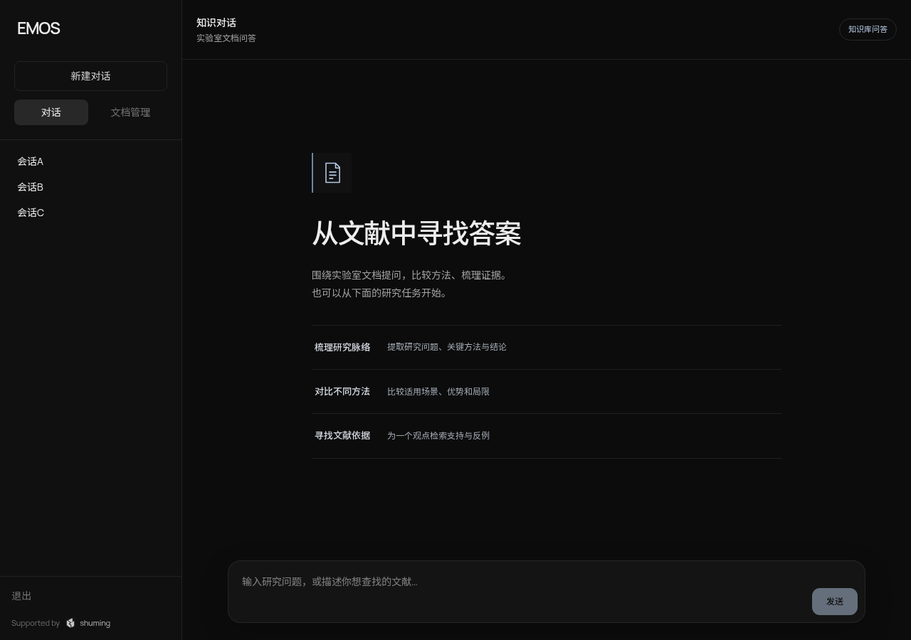
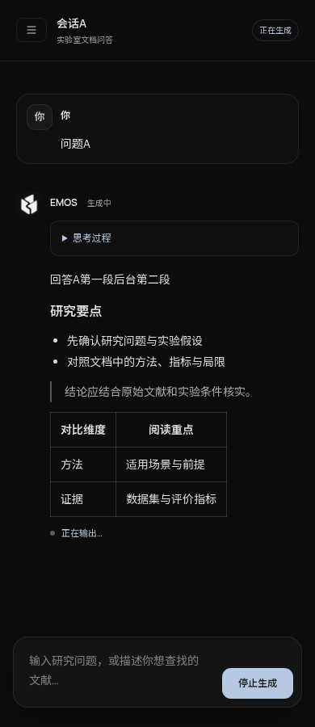

# 对话窗口设计方向

参考并应用：[Anthropic 官方 frontend-design skill](https://github.com/anthropics/skills/tree/main/skills/frontend-design)，读取版本 blob `a5333457c414d20d625f307df945842c0952ecc3`。配合 frontend-engineer 的构建、无障碍和真实浏览器验证流程。

## 计划

- 受众和工作：实验室研究人员围绕文献提问，长时间阅读与比较模型答案；不是营销落地页。
- 色彩：保留原有深色身份，背景 `#0c0c0c`、侧栏 `#101010`、表面 `#141414`、正文 `#ededed`、辅助文字 `#a3a3a3`、交互强调 `#b5c9e2`。
- 字体：复用本地 Manrope / Noto Sans SC。标题 27–38px，答案 14px / 1.85 行高，辅助信息 10–12px；正文居左，限制阅读宽度。
- 布局：固定会话导航 / 当前研究对话与消息阅读区 / 底部多行输入。助手答案不套厚重聊天气泡；用户问题用轻边界区分。思考过程可折叠，不与最终答案混排。
- 原则：研究任务优先、内容优先、状态真实、键盘和移动端可用。不生成虚假的文献、检索结果或系统连接状态。

```text
会话导航 | 当前会话标题                     状态
         | 用户问题
         | 助手 · 思考过程（可展开）
         | Markdown 回答
         | 复制回答
         |                   查看最新回答
         | 多行输入                     发送/停止
```

## 方案自审与修订

初稿的全大写英文装饰标签、泛用标语、三张同形卡片和薄荷色强调过于模板化。第二轮删除这些装饰：用文献页线稿与直接说明任务的标题；研究任务改为单组分隔列表，每项补充实际用途，并填入可编辑的研究问题模板；强调色改为低饱和钢蓝。保留原有产品名与暗色体系，避免为美化擅自更换品牌。

阅读长回答时暂停自动跟随，并提供“查看最新回答”入口；手机导航图标使用内联 SVG 避免字体缺字。

## 浏览器验收截图

以下来自本地生产构建的真实 Chromium，使用可控模拟会话和 SSE 数据，不代表生产模型回答。






### 反馈修订（2026-10-23）

助手头像复用项目现有的枢明书页标志，以反白方式适配深色界面，替代方框中的 E；不新增图标系统。移除输入框下方整行快捷键与免责声明文字，保留 Enter / Shift+Enter 行为。
